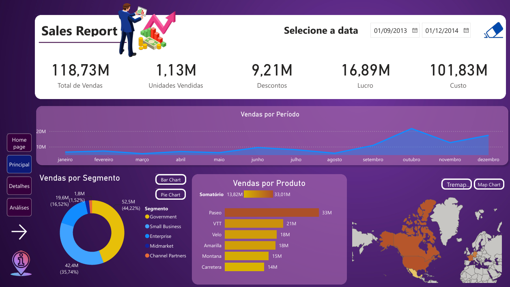
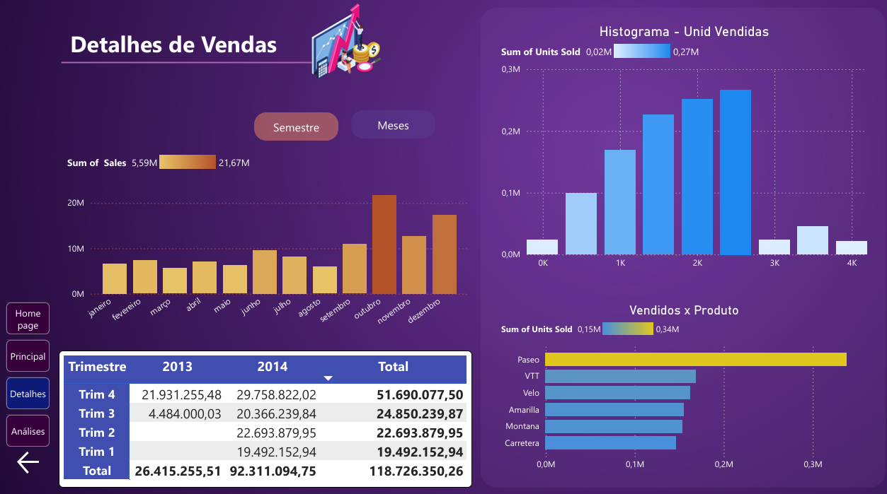
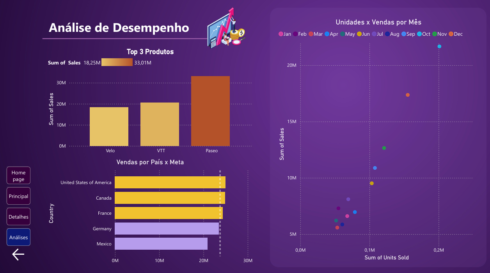

# Relatório Financeiro com Foco na Experiência do Usuário | Power BI

Projeto desenvolvido no desafio **Data Analytics com Power BI** (DIO). O objetivo foi pegar o relatório financeiro criativo do primeiro projeto e reformulá-lo pensando em como o cliente consome a informação: posicionamento, contraste, proporção áurea, segmentação de dados e navegação entre páginas.

## Páginas do relatório

| Página | Conteúdo |
|---|---|
| **Home page** | Capa da turma |
| **Principal (Sales Report)** | Visão geral: cartões de KPI (vendas, unidades, descontos, lucro, custo), vendas por período, vendas por segmento (rosquinha/barras), vendas por produto e mapa por país, com filtro de data |
| **Detalhes** | Vendas por mês e por semestre (alternados por botões), matriz de vendas por trimestre e ano, histograma de unidades vendidas e unidades por produto |
| **Análises** | Top 3 produtos, vendas por país comparadas a uma meta e dispersão de unidades vendidas x vendas por mês |




## O que foi feito

**Experiência do usuário**
- Layout em grade, com os visuais mais importantes no topo e à esquerda e um painel grande à direita, seguindo a proporção áurea como referência.
- Paleta roxa com degradês de cor por valor, para destacar o que importa sem poluir.
- Segmentações (data, mês) alinhadas e com o mesmo estilo em todas as páginas.
- Menu de navegação em todas as páginas, com estados diferentes para **focalizar** e **selecionado**.
- Botões **Semestre / Meses** que alternam os gráficos usando indicadores (bookmarks).

**Recursos de análise**
- **Histograma** de unidades vendidas, criado com agrupamento em compartimentos (bins de 500).
- **Top N**: filtro dos 3 produtos com mais vendas.
- **Cor condicional + meta**: no gráfico de países, a cor da barra depende de a venda bater ou não a meta, e uma linha de referência mostra o valor da meta.
- **Dispersão** de unidades vendidas x vendas, com um ponto por mês e legenda com meses abreviados.
- **Drill down** de continente para país.

## Medidas e colunas DAX

```dax
-- Coluna calculada: semestre de cada venda
Semestre =
IF ( financials[Month Number] <= 6, "Primeiro Semestre", "Segundo Semestre" )

-- Meta por país: média de vendas entre todos os países
Meta País =
AVERAGEX ( ALL ( financials[Country] ), [total sales] )

-- Cor da barra conforme a meta (usada em Cor > fx > Valor do campo)
Cor Barra =
IF ( [total sales] >= [Meta País], "#F2C230", "#B79CED" )
```

Também foram usados: um grupo de compartimentos (bins) em `Units Sold` para o histograma e uma coluna com as 3 primeiras letras do mês (criada no Power Query) para a legenda da dispersão.

## Como abrir

1. Baixe o arquivo `.pbix` deste repositório.
2. Abra no **Power BI Desktop**.
3. Para testar os botões de navegação no Desktop, use **Ctrl + clique**.

## Estrutura do repositório

```
├── relatorio-financeiro.pbix
├── README.md
└── imagens/
    ├── principal.png
    ├── detalhes.png
    └── analises.png
```

## Tecnologias

- Power BI Desktop
- DAX
- Power Query
